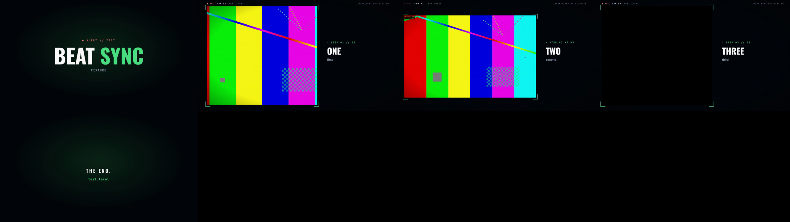

# heist-cam

**Product videos cut from your real web UI, in a style you pick: kinetic (beat-locked type), keynote (calm, for presentations, with slide clips), social (vertical, captioned) or heist (CCTV). Fully scripted, with no video editor.**

heist-cam is a [Claude Code](https://claude.com/claude-code) skill. Ask Claude for "a demo video of the new dashboard" and it:
1. agrees the story with you;
2. drives your actual app in Chrome and records one short clip per step;
3. lays the style over the footage, never covering it with text:
   - **kinetic**: huge words that slam in on the beat, colour-flip grounds between scenes, hard cuts, the whole screen beside the type (or after a title card, or in a tilting window) pushing in slowly, a typed subtitle; loads and waits fast-forwarded with a small `››› 8×` chip;
   - **keynote**: calm and premium, for presentations: titles glide in above a still browser-window frame, the camera eases into where the action is with a soft spotlight and a callout beside the window, a chapter bar below, soft cuts and a whoosh; plus one looping clip and a poster per scene to drop onto slides;
   - **social**: vertical 1080×1920 for LinkedIn and Shorts: a hook title in the first second, the footage in a window whose crop pans after the action, big word-by-word captions in their own band, hard cuts on the beat;
   - **heist** (the default when no style is given): a surveillance HUD: a blinking REC light, a running timestamp, `CAM 01 // PLACE` labels, brackets that lock onto the footage, titles that decode from random glyphs, typed subtitles, a glitch at every cut, grain and scanlines;
4. cuts on the beat of your music, adds a sound on each cut, and adds an optional voice-over;
5. measures the result before you share it.


<sub>The contact sheet from a build of the test fixture (test patterns in place of a real UI). Every build writes one to `out/contact.png`.</sub>

## How it works

```
 record.mjs (Playwright)        video.json                    music / voice
 real clicks, real typing  ─┐   brand, scenes, titles,  ─┐    beat grid, sfx, TTS
 one clip per step          │   crops, end card          │          │
                            ▼                            ▼          ▼
                     ┌──────────────── build.py ─────────────────────────┐
                     │ trim each clip to its action · speed up · crop     │
                     │ find the action (zoom / pan) · snap cuts to beat   │
                     │ styles/<style>/hud.html, frame by frame (fn of t)  │
                     │ overlay · mix audio · H.264 high@4.1, faststart    │
                     └───────────────────────┬───────────────────────────┘
                                             ▼
                          check.py → PASS / WARN / FAIL + contact sheet
```

- **All on-screen text is HTML.** Each style's `hud.html` defines `window.render(t)` as a pure function of time. A headless Chrome screenshots it frame by frame (transparent PNGs for heist; kinetic, keynote and social draw the footage too, from extracted frames, as JPEGs), and ffmpeg lays them over the footage.
- **The camera looks where the action is** (keynote, social): at boxes the recorder logged (`glide()`, `focus()`), at a `focus` you give, or where the recording changes (frame differencing over what the viewer sees, scrolls set apart; see the playbook). Every run comes out the same, and no ffmpeg text filter is needed (some ffmpeg builds don't have `drawtext`).
- **Real footage only.** It never uses mockups. The recording waits for real responses. The video doubles as QA: if a frame shows a UI bug, report the bug rather than editing around it.
- **Everything specific to a video lives in one `video.json`:** brand, texts, logos, music and voices. Nothing is tied to a particular machine or repo.

## Install

```bash
git clone git@github.com:davidbalzan/heist-cam.git ~/.claude/skills/heist-cam
cd ~/.claude/skills/heist-cam/scripts && npm install
python3 ~/.claude/skills/heist-cam/scripts/doctor.py
```

`doctor.py` checks everything the skill needs and prints the exact fix for anything missing:

| Required | Why |
|---|---|
| Python 3.8+ with numpy | the build, beat detection and checks |
| ffmpeg + ffprobe with libx264 | assembly; the doctor also checks for the filters the build uses |
| Node 20+ | recording and the HUD render |
| Google Chrome | recording uses the installed Chrome through [patchright](https://github.com/Kaliiiiiiiiii-Vinyzu/patchright), a Playwright fork that real sites challenge less |
| `npm install` in `scripts/` | installs patchright |

Voice is optional. See [Voice](#voice).

## Use it

In Claude Code, run `/heist-cam` or just ask for a demo video, explainer, walkthrough, trailer or slide clips. Claude runs the doctor, helps you fix anything missing, then works through the steps below. To do it by hand:

```bash
mkdir my-video && cp ~/.claude/skills/heist-cam/examples/* my-video/ && cd my-video
# 1. edit record.mjs (your steps), then record the real UI
node record.mjs                                   # → clips/<name>/*.webm + clips/clips.json
#    logged-in site? a PERSON logs in first; the agent never handles credentials:
node ~/.claude/skills/heist-cam/scripts/login.mjs https://app.example.com ~/.cache/heist-cam/profile
# 2. edit video.json, validate it
python3 ~/.claude/skills/heist-cam/scripts/config.py video.json
# 3. HUD-only contact sheet, then the full build (checks run at the end)
python3 ~/.claude/skills/heist-cam/scripts/build.py video.json --sheet
python3 ~/.claude/skills/heist-cam/scripts/build.py video.json
```

Look at `out/contact.png` and watch the video before sharing it. The checks don't replace looking.

## `video.json`

See [`examples/video.example.json`](examples/video.example.json). The build rejects unknown keys (with a "did you mean"), wrong types and missing files before it does any work.

| Key | What |
|---|---|
| `style` | `kinetic`, `keynote`, `social` or `heist` (the default); any folder under `styles/` (see [Styles](#styles)) |
| `mode` | `tutorial` (default; keeps 2–3 s holds so results can be read) or `trailer` (fast, ≤1.5 s holds) |
| `speed` | playback speed of the footage (default 1.5; social 2) |
| `fastForward` | play still stretches (loads, waits) at up to 8× so each lasts ~0.25 s, keeping the clip's final hold; default on for kinetic, keynote and social, off for heist |
| `fit` | `full` (default) or `content`: crop each clip to where the UI is (blank page and Playwright's grey padding cut away, padded 2 %) |
| `layout` | kinetic: `split` (default; the screen on the right, the type in a left column), `cards` (a title card before each scene, then the screen at ~90 % height over a slim caption bar) or `window` (a tilting rounded window beside the title); keynote: `above` (default) or `beside`; social: `phone`. The screen keeps its aspect (4:3 to 21:9, letterboxed beyond; social crops it) and nothing is drawn over it |
| `zoom` | keynote/social: the closest the camera goes (keynote 1.3–2.2× by default, social 1.6–2.2×); `1` turns the camera off |
| `exports` | keynote: `slides` (default on) writes `out/slides/NN-<clip>.mp4` + `.png` + `index.md`; `aspect` `"16:9"` (default) or `"4:3"` |
| `brand` | `accent` / `alert` / `glow` (6-digit hex), `site` label, `date`, starting `clock`; kinetic and social also use `ground` (the dark background) and `palette[]` (flip grounds and highlights), both derived from `accent` when left out; keynote tints a deep slate toward `ground`, or uses it as is when it is light |
| `intro` | `len`, `alert` line, `title`, `sub` |
| `scenes[]` | `clip`, `kind` (heist: `desk` / `wide` / `phone` / `full`, where `full` is 16:10, the whole screen beside the title), optional `crop` `[x,y,w,h]` to zoom (wins over `fit`), `cam`, `title` as `[["TEXT ", ""], ["ACCENT", "a"]]`, `sub`; keynote/social: `callout` (2–4 words naming the zoomed region), `chapter` (short label in the chapter bar), `focus` `[x,y,w,h]` (recording pixels; where the camera looks, over logged boxes and motion), `zoom`; per scene `speed`, `fastForward`, `fit`, `layout`, and `ramps` `[{from, to, speed}]` (seconds into the clip's action) to fast-forward a stretch by hand |
| `end` | `logo[]` (SVG, or PNG/WebP/JPEG with a transparent background), `logoHeights`, `line`, `url`, `blink` (default on when an SVG logo has elements marked `data-blink` or `class="blink"`: they blink, around their own centre) |
| `music` | `file`, `sync` (`true` = the style's choice, keynote cuts on the bar; or `beat` / `bar`), `bpm` / `offset` / `barOffset` overrides, `fadeIn`, `fadeOut`, `volume` |
| `sfx` | `cut` (`"auto"` or a file) plays on every cut, plus `events[]` `{at, file}` |
| `voice[]` | `{file, start, text}`, as written by `voice.mjs`; add `scene` (`0` intro, `1..n` a scene, `"end"`) to make `start` relative to that scene's cut, so lines follow the timeline when cuts move. Social captions are made from `text` |
| `checks` | override `maxHold`, `maxStill`, `minEndHold`, `minVoiceMatch`; `stt` provider; `transcribe: false` |

### Styles
A style is a folder `styles/<name>/` holding `hud.html` (defines `window.render(t)`, loads the shared `../common.js`) and `style.json`, the settings the build reads:

| Setting | heist | kinetic | keynote | social |
|---|---|---|---|---|
| `size` | 1920×1080 | 1920×1080 | 1920×1080 | 1080×1920 |
| `cut` | `glitch` (RGB split + noise, HUD glitch bars) | `hard` | `soft` (a dissolve inside the still frame) | `hard` |
| `cutSound` (for `sfx.cut: "auto"`) | `static` | `thump` | `whoosh` | `thump` |
| `grain`, `scanlines` | on | off | off | off |
| `grade` (ffmpeg filter on the footage) | slight contrast up, saturation down | none | none | none |
| `footage` | `canvas`: ffmpeg places it in a rect | `hud`: the HUD draws it | `hud` | `hud` |
| `camera` | none | none | `zoom` (ease in, hold, ease out; spotlight, callout) | `pan` (a crop that follows the action) |
| `beatGrid` / `sync` | off | on: cuts and word slams on the beat | off; music sync on the bar | on |
| `leadBeats` | 0 | 2: a title card before each scene's footage | 0 | 0 |
| `fastForward`, `fit` | off, `full` | on, `full` | on, `full` | on, `full` |
| extras | | | `slides` exports | `captions`, `speed` 2 |
| `rects` / `layouts` | rect per `kind` | `split`, `cards`, `window` | `above`, `beside` | `phone` |

Another style is a copy of the closest folder with its own `hud.html` and `style.json`; `config.py` lists it automatically. Helpers shared by every HUD (colour, easing, the camera's `viewAt`, the logo blink) live in `styles/common.js`; a HUD must not define them again.

### Beat sync
Kinetic cuts on a beat grid even without music: `music.bpm` if given, otherwise 120 BPM. With `"sync": "beat"` (or `"bar"`), `beats.py` finds the track's beat grid using only numpy and ffmpeg. Each cut then moves **later** to the next beat or bar, never earlier, so a tutorial keeps its holds; the clip's last frame is held to fill the gap. It assumes a steady tempo, which is fine for the usual music beds. The grid is written to `out/beats.json`. On a test loop it put cuts within 12 ms of the true beat.

## Checks

`check.py` runs after every build and writes `out/check.json`. Any FAIL makes the build exit non-zero.

| Check | FAIL / WARN when |
|---|---|
| length | the file doesn't match the timeline |
| phone playback | not H.264 yuv420p, or above level 4.2 up to 1080p in either orientation (older phones and TVs refuse it; 1080×1920@30 is 4.1) |
| faststart | the `moov` box comes after `mdat`, so web players must download the whole file first |
| blank footage | a scene's recording is empty, or the crop misses it |
| holds | a frozen stretch is too long, too much of a scene is still, or the result isn't held long enough to read (limits depend on the mode) |
| loudness | outside -18..-10 LUFS integrated; true peak above -1 dBTP |
| voice | each line, heard back **from the final mix** at its slot, matches less than 80% of its text (buried under the music or cut off) |

## Voice

`node scripts/voice.mjs lines.json out/vo [--provider elevenlabs|google]` generates each line, transcribes it back and regenerates it (up to 3 tries) until it matches and fits its slot.

| Provider | Auth (environment only) | Voices |
|---|---|---|
| ElevenLabs | `ELEVENLABS_API_KEY` | voice IDs; the playbook lists the ones that worked |
| Google Cloud TTS | `GOOGLE_API_KEY` (restrict it to Text-to-Speech + Speech-to-Text), **or** `gcloud auth login` + `GOOGLE_CLOUD_PROJECT` | e.g. `en-US-Chirp3-HD-Charon` (default), `en-GB-Chirp3-HD-Algenib` |

Keys go in the environment, never in an argument or a file. If you use the gcloud login, set `GOOGLE_CLOUD_PROJECT`. Otherwise Google bills your gcloud default project, which may be a production one. The doctor warns about this.

## Layout

```
SKILL.md               what Claude reads: setup step, workflow, rules
reference/PLAYBOOK.md  the look, what worked and what was rejected, voices, traps
examples/              record.example.mjs, video.example.json
scripts/
  doctor.py            setup check with fixes
  rig.mjs, login.mjs   recording helpers; a person logs in
  config.py            video.json validation
  beats.py             beat grid (numpy + ffmpeg)
  build.py             the assembly
  content.py           finds where the UI is in a clip (fit: "content")
  focus.py, camera.py  finds where the action is; plans keynote's zoom and social's pan
  captions.py          word-by-word captions from the voice lines (social)
  slides.py            per-scene slide clips and posters (keynote)
  render.mjs           renders a style's HUD frame by frame
  check.py             post-build checks
  speech.mjs, voice.mjs  TTS/STT providers and voice-over generation
styles/
  common.js            helpers shared by every HUD (colour, easing, camera, the logo blink)
  heist/, kinetic/, keynote/, social/   hud.html + style.json per style
```

## Credits

The beat-grid cutting and the automated render checks are inspired by Scenario's [Kinetic Film](https://www.scenario.com/explorations/kinetic-film/). Validating the config strictly comes from [OpenKatana](https://github.com/rk0neki/OpenKatana).
